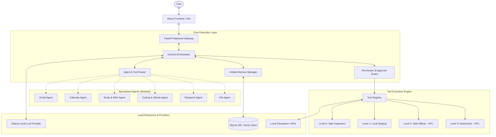

# Personal AI OS — System Architecture

## 1. Executive Overview

Personal AI OS is a local-first, privacy-respecting, autonomous agentic platform designed to act as a unified operating system for personal intelligence, tasks, documents, and external actions. 

The core thesis of Personal AI OS is:
- **Zero Operating Cost**: Built around local open-source models executed through [Ollama](https://ollama.ai) with zero continuous cloud API billing.
- **Human-in-the-Loop Safety**: Consequential actions (sending emails, modifying repositories, deleting files) are strictly guarded by formal permission levels.
- **Provider Independence**: Core agent components interact with abstract LLM and memory interfaces, allowing models and vector backends to be interchanged.
- **Comprehensive Observability**: Every reasoning step, tool call, and agent handoff produces structured activity events surfaced to the user.

---

## 2. High-Level System Architecture

---

## 3. The 9-Step Orchestrator Lifecycle

The user interacts exclusively with one central Orchestrator Agent. The orchestrator decomposes requests and orchestrates sub-agents through nine explicit lifecycle phases:

1. **Receive Request**: Ingest user message, assign conversation ID, and initialize the run trace.
2. **Understand Intent**: Classify intent, extract parameters, and formulate high-level task goals.
3. **Retrieve Context**: Pull conversational history, user preferences, long-term facts, and relevant semantic document chunks.
4. **Agent & Tool Routing**: Determine whether specialized agents (Gmail, Calendar, Study, etc.) or individual tools are required.
5. **Plan**: Generate an observable step-by-step execution roadmap.
6. **Permission Check & Execute**: Evaluate tool safety levels against the Permission Matrix. Request human confirmation if Level 2 or 3 is encountered.
7. **Observe Results**: Ingest execution outputs, error codes, and telemetry from tools and sub-agents.
8. **Refine / Continue**: If a step failed or additional steps are required, dynamically revise the plan.
9. **Synthesize Final Response**: Compile a coherent, citation-backed response and stream it alongside complete activity traces.

---

## 4. Specialized Agents

| Agent | Focus Area | Planned Tools & Responsibilities |
|---|---|---|
| **Gmail Agent** | Email Triage & Automation | Search, read, draft replies, send email (HITL), label, trash (HITL), task extraction. |
| **Calendar Agent** | Time Management | Read agenda, free/busy detection, conflict resolution, natural language event scheduling. |
| **Study Agent** | Learning & Academic RAG | PDF/slide ingestion, semantic vector retrieval, quiz generation, weak topic tracking. |
| **Coding Agent** | Software Engineering | Repo inspection, architecture mapping, test runner, bug fixing, git branching/PRs (HITL). |
| **Research Agent** | Open Web Synthesis | Multi-source zero-cost scraping, fact cross-checking, objective synthesis, citations. |
| **File Agent** | Local Filesystem | Semantic desktop indexing, file organization, content extraction, safe file moving. |

---

## 5. Security & Permission Architecture

Actions are partitioned into 4 hierarchical permission tiers:

| Level | Classification | Impact | Examples | Default Approval |
|---|---|---|---|---|
| **LEVEL 0** | Read-Only | Zero external change | Search emails, read calendar, inspect files | Auto-approved |
| **LEVEL 1** | Low Impact | Staged / non-destructive | Draft email, create draft calendar invite, tag label | Auto-approved |
| **LEVEL 2** | External Side Effects | Real-world consequences | Send email, post to GitHub, update calendar event | **Explicit Confirmation** |
| **LEVEL 3** | Destructive | Irreversible changes | Delete emails, delete files, bulk modifications | **Strict Confirmation** |

---

## 6. Memory Subsystem Architecture

Personal AI OS organizes memory across 5 distinct facets:

1. **Conversation Memory**: Short-term conversational context buffer preserving recent turns.
2. **Long-Term Memory**: Persistent key-value store containing explicit user facts (e.g., job role, preferred libraries, family contacts).
3. **Semantic Memory**: Document chunks indexed for keyword and dense vector semantic retrieval (for notes, PDFs, research papers).
4. **Episodic Memory**: Log of past problem-solving sessions, task outcomes, and agent learnings to improve future routing.
5. **Preference Memory**: High-level behavioral rules, default agent preferences, and system tone guidelines.

---

## 7. Zero-Cost Local LLM Strategy

- **Primary Provider**: Local Ollama daemon running models such as `llama3.2`, `qwen2.5-coder`, or `mistral`.
- **Fault-Tolerant Fallback**: If the Ollama service is stopped, the application reports its offline status via `/health` and maintains full UI/backend functionality without crashing.
- **Provider Abstraction**: All LLM interactions flow through `BaseLLMProvider`. Custom providers (e.g. llama.cpp, vLLM) can be added by implementing standard generation and chat methods.
